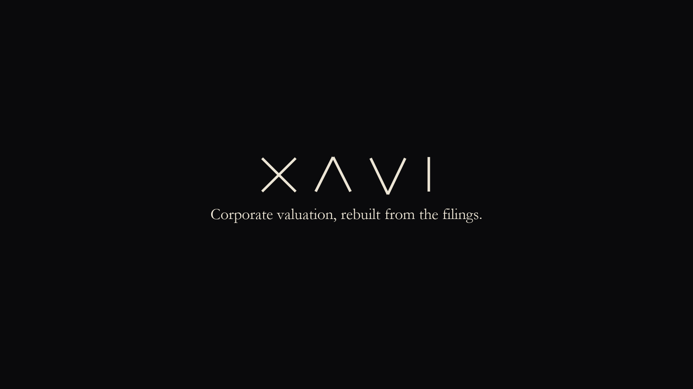

# XAVI · Corporate valuation suite

Shell and BP, built from their SEC filings: a 3-statement forecast, DCF, Monte Carlo risk, a carve-out LBO, a
Shell + BP merger model, a 13-asset sterling portfolio, an interactive dashboard, an Excel workbook with live
formulas, and an audit. Not investment advice.

## Watch
- [Narrated explainer, desktop](demo/XAVI_explainer_desktop.mp4) (6 min)
- [Narrated explainer, mobile](demo/XAVI_explainer_vertical.mp4) (6 min)
- [Short film](demo/XAVI_demo.mp4) (73 s, no voice)

Open a file and choose **View raw** (or download) to play it.

## What's inside
| | |
|---|---|
| Data | Shell and BP Form 20-F filings (SEC EDGAR), FY2021–25; Shell's segment note; market data from Yahoo Finance |
| Forecast | 10-year integrated income statement, balance sheet and cash flow |
| Valuation | DCF with an enterprise-to-equity bridge, sensitivities and a 10,000-path Monte Carlo |
| Buyout | Carve-out LBO of a Shell division: debt schedule, cash sweep, IRR, maximum price |
| Merger | Shell acquires BP: purchase accounting, pro forma statements, EPS accretion, value test |
| Portfolio | 13 assets in GBP: efficient frontier, VaR, stress tests, walk-forward backtest |
| Proof | Excel workbook with 1,082 live formulas reconciling to Python; 86 audit checks; 87 tests |

Every assumption is listed in [docs/ASSUMPTIONS.md](docs/ASSUMPTIONS.md); methods and limits in
[docs/METHODOLOGY.md](docs/METHODOLOGY.md).

## Run the dashboard
    py -3.12 -m pip install pandas numpy scipy streamlit plotly yfinance requests openpyxl pytest
    py -3.12 -m streamlit run app.py

Run it from this folder so the XAVI theme in `.streamlit/config.toml` is used.

## Excel workbook
    py -3.12 export_excel.py                              # writes output/XAVI_valuation_model.xlsx
    powershell -ExecutionPolicy Bypass -File recalc_excel.ps1   # Excel recalculates it (needs Microsoft Excel)
    py -3.12 verify_excel.py                              # no formula errors + every line reconciles to Python

The workbook uses iterative calculation (interest on average balances). A circularity switch on the Inputs and LBO
sheets falls back to opening balances if needed.

## Refresh the data, then re-check
    py -3.12 fetch_sec.py          # SEC downloads -> data/raw (set SEC_USER_AGENT to 'Name email' first)
    py -3.12 extract.py            # SEC 20-F XBRL facts -> data/clean/*_annual.csv
    py -3.12 extract_segments.py   # Shell segment note -> data/clean/shell_segments.csv (needs the full 20-F text in data/raw)
    py -3.12 fetch_prices.py       # basket, Shell, BP, FTSE 100 ETF, GBP/USD
    py -3.12 fetch_market.py       # share counts, betas, US 10y and 13-week yields (run after fetch_prices)
    py -3.12 -m pytest -q          # 87 tests
    py -3.12 audit.py              # 86 integrity checks -> output/audit_report.md

`run_forecast.py` and `run_dcf.py` print the Shell (or BP: add `bp`) forecast and DCF in the terminal.

## Demo film
    py -3.12 demo/capture.py   # drives the dashboard headlessly at 2x and saves stills (needs: pip install playwright imageio imageio-ffmpeg pymupdf; playwright install chromium)
    py -3.12 demo/render.py    # -> demo/XAVI_demo.mp4 (1920x1080, ~73 s) and demo/XAVI_poster.png
    py -3.12 demo/explainer.py both   # narrated explainers: demo/XAVI_explainer_vertical.mp4 (1080x1920) and _desktop.mp4 (1920x1080)
                                       # script and voice in demo/script.py; voice = Microsoft neural (edge-tts, sends text to Microsoft)

`capture.py` also exports the Excel stills through Microsoft Excel (`demo/export_excel_stills.ps1`).

## Layout
- `model/three_statement.py`  integrated forecast; also runs from any opening balance sheet
- `model/dcf.py`, `model/montecarlo.py`   valuation and simulation
- `model/segments.py`, `model/lbo.py`, `model/lbo_setup.py`   carve-out LBO
- `model/ma.py`               Shell acquires BP
- `model/portfolio.py`        sterling portfolio, optimisers, risk, backtest
- `model/pipeline.py`, `model/setup.py`   wiring
- `ui/`, `app.py`             dashboard: Overview, Financials, Valuation, Risk, Buyout, Deal, Portfolio, Method & data
- `export_excel.py`, `recalc_excel.ps1`, `verify_excel.py`   Excel workbook
- `audit.py`                  integrity checks
- `docs/ASSUMPTIONS.md`       every assumption, its basis and where to change it
- `docs/METHODOLOGY.md`       how each model works, how it is verified, its limits
- `assets/`                   XAVI logo and favicon
